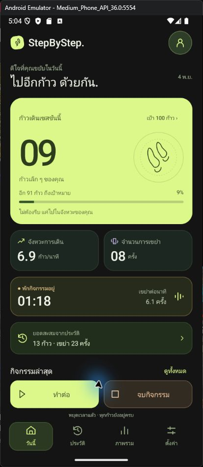
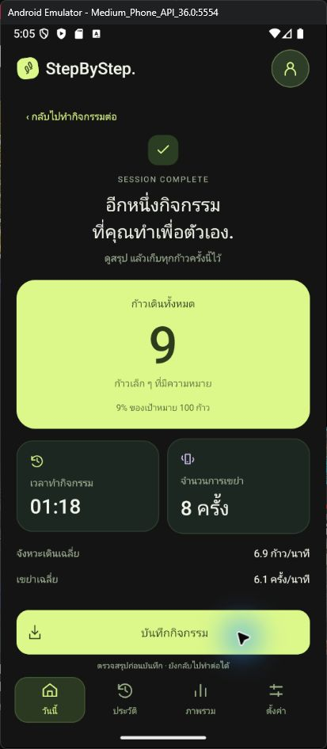
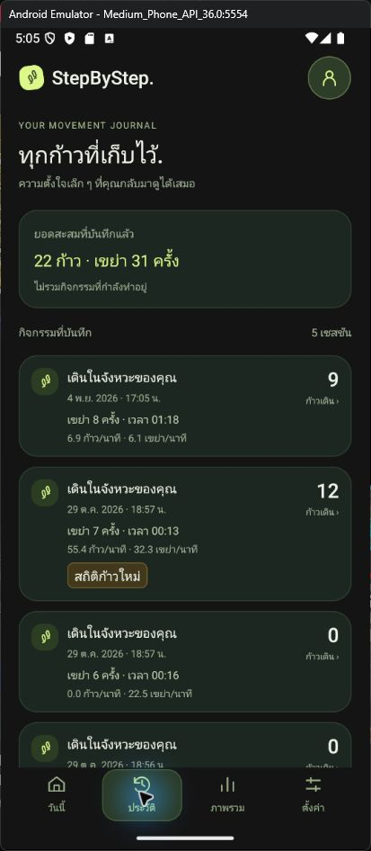

# StepByStep

โปรเจกต์ Android Native ด้วย Java + XML ตามดีไซน์ Forest / Citron / Lilac ที่เลือกไว้ เปิดใน Android Studio และรันดูหน้าจอได้ ใช้ข้อมูลตัวอย่างสำหรับตรวจงาน UI

## ภาพตัวอย่าง

| หน้าหลัก | หน้าสรุป | ประวัติ |
|---|---|---|
|  |  |  |

## เปิดโปรเจกต์

1. แตก ZIP แล้วเปิดโฟลเดอร์ `StepByStep` ด้วย Android Studio → Open
2. เลือก Gradle JDK ที่มากับ Android Studio (รองรับ Java 17 ขึ้นไป) แล้วรอ Gradle Sync
3. ใช้ Android SDK Platform 35; Emulator/โทรศัพท์ Android 8.0 ขึ้นไป
4. กด Run ที่โมดูล `app`

Gradle Wrapper รวมมาให้ครบ: Gradle 9.5.0 / Android Gradle Plugin 9.3.2 ตามเครื่องมือที่ใช้ตรวจโปรเจกต์นี้ ต้องใช้ Android Studio ที่รองรับ AGP รุ่นนี้ หากเพื่อนใช้ Studio เก่าต้องอัปเดตหรือปรับคู่เวอร์ชัน Gradle/AGP ให้เข้ากับเครื่อง

ครั้งแรกต้องใช้อินเทอร์เน็ตสำหรับ Gradle และ RecyclerView 1.4.0 ซึ่งเป็นไลบรารี UI ของ AndroidX ส่วนตัวแอปไม่ได้ใช้เครือข่าย ไม่มี WebView และไม่ต้องโหลด HTML มาแสดง

## หน้าที่ออกแบบ UI ที่ส่งมอบ

- XML แยกหน้าหลัก ประวัติ ภาพรวม ตั้งค่า และสรุป
- XML รายการประวัติ พร้อม RecyclerView Adapter / ViewHolder และ stable ID
- Bottom sheet: รายละเอียด ยืนยันลบ เป้าหมาย เครื่องมือจำลอง และสถานะสิทธิ์/ไม่มีเซนเซอร์
- ธีม สี ไอคอน Vector Drawable พื้นหลัง ปุ่ม และกราฟแบบ Native
- ปุ่มหลักด้านล่างสูง 56dp: เริ่ม → พัก → ทำต่อ / จบ → สรุป → บันทึก
- ยอดสะสม สถิติใหม่ทั้งก้าวและเขย่า การลบและเลิกทำ แสดงด้วยข้อมูลตัวอย่าง
- ปรับตาม system bars, cutout และการหมุนหน้าจอได้ หน้าหลักเลื่อนได้และปุ่มควบคุมยังอยู่ด้านล่าง

## ลองหน้าจอและสถานะ

เปิดครั้งแรกจะเห็นตัวอย่าง 9 ก้าว / 8 เขย่า / เวลา 00:49 และเดินเวลาต่อ ค่าเหล่านี้เป็น fixture เพื่อให้เห็นดีไซน์ทันที

- กดพัก → ทำต่อ หรือจบ → สรุป → บันทึก (เพิ่มเฉพาะข้อมูลในหน่วยความจำ)
- ไปตั้งค่า → เปิดเครื่องมือจำลอง เพื่อเพิ่มก้าวและเขย่าขณะทำกิจกรรม หรือเลื่อนหน้าหลักลงไปที่ปุ่มทดลอง
- แตะประวัติ → รายละเอียด → ลบ → ยืนยัน; เลิกทำได้ภายใน 8 วินาที
- แก้เป้าหมายจากการ์ดก้าวหรือหน้าตั้งค่า
- หน้าตั้งค่ามีตัวอย่าง ขอสิทธิ์ / ไม่อนุญาต / ไม่มีเซนเซอร์ โดยไม่ขอสิทธิ์จริงจาก Android
- กิจกรรมพักเมื่อออกจากแอป ไม่ติดตามเบื้องหลัง

ประวัติตัวอย่างอยู่ในหน่วยความจำเท่านั้น เก็บผ่านการหมุนหน้าจอด้วย saved instance state แต่จะไม่เป็นประวัติถาวรเมื่อเปิดแอปใหม่เต็มรูปแบบ ตัวเลือกเริ่มอัตโนมัติเก็บด้วย UI preference เล็กน้อย แยกจากประวัติกิจกรรม

## จุดรับช่วงของเพื่อน

อ่าน `INTEGRATION.md` สำหรับ mapping ปุ่ม/สถานะ/ข้อมูล ไฟล์หลักที่ควรเริ่ม:

- `app/src/main/java/com/stepbystep/ui/ActivityUiActions.java` — สัญญาการกดปุ่มสำหรับเชื่อมระบบ
- `app/src/main/java/com/stepbystep/ui/model/ActivityUiState.java` — ข้อมูลที่ใช้วาดหน้าจอ
- `app/src/main/java/com/stepbystep/ui/MainActivity.java` — renderState และการเปิดหน้าจอ
- `app/src/main/java/com/stepbystep/ui/demo/UiPreviewController.java` — ส่วนจำลองที่เพื่อนเปลี่ยนเป็นเซนเซอร์/SQLite

ยังไม่ได้เชื่อมเซนเซอร์ SQLite สิทธิ์จริง หรือ background service ตามการแบ่งงานของกลุ่ม ห้ามใช้สถานะจำลองเป็นหลักฐานว่าระบบเหล่านั้นทำงานแล้ว

Checklist Excel ทางการยังไม่ได้รับ ชุด UI อ้างอิงส่วนที่เห็นใน MA12.pdf หน้า 36/39 และคำอธิบายในบันทึกคลาส ต้องตรวจ checklist ทั้ง 10 ข้ออีกครั้งเมื่อเพื่อนได้ไฟล์
