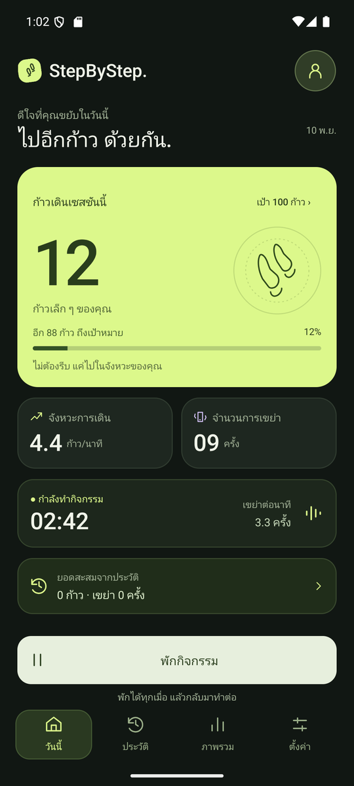
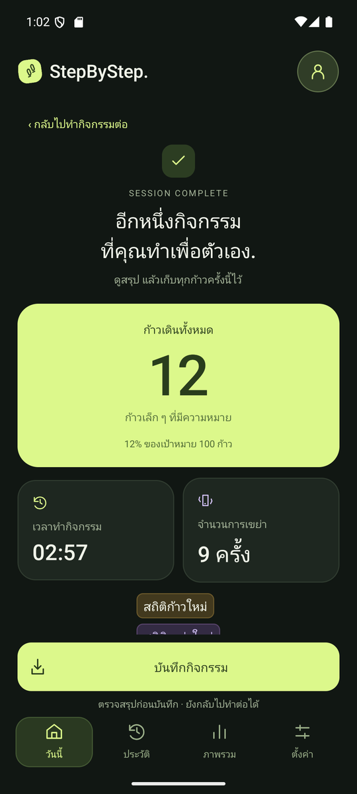
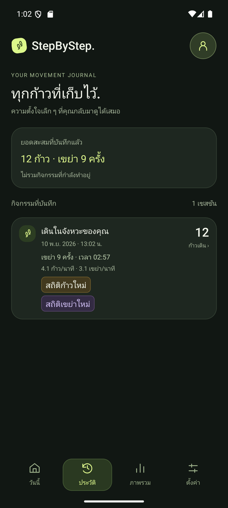
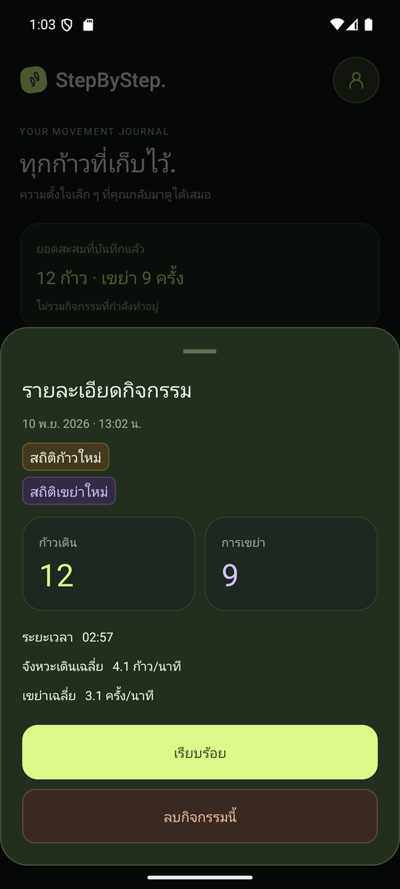
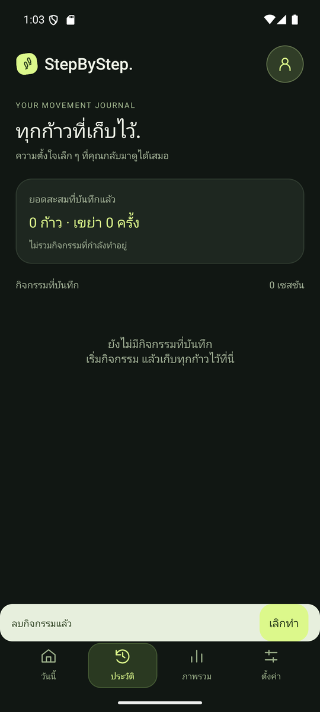

# StepByStep — CS364 Assignment 2

แอป Android สำหรับนับก้าวเดินและจำนวนครั้งที่เขย่า พร้อมจับเวลา คำนวณค่าเฉลี่ย และเก็บประวัติกิจกรรมถาวร พัฒนาแบบ Native ด้วย **Java, XML, RecyclerView และ SQLite**

- นับก้าวจากเซนเซอร์ `Sensor.TYPE_STEP_COUNTER`
- นับการเขย่าจาก `Sensor.TYPE_ACCELEROMETER`
- บันทึก อ่าน และลบประวัติด้วย SQLite แล้วแสดงผลใน RecyclerView

## สำหรับ TA: เริ่มตรวจใน 3 ขั้นตอน

1. ดาวน์โหลด `StepByStep-assignment2.apk` จากหน้า [Releases](https://github.com/dannypsx/StepByStep/releases/latest) แล้วติดตั้งบน**เครื่องจริง** Android 8.0 ขึ้นไป
2. เปิดแอปแล้วกด **อนุญาต** สิทธิ์ "กิจกรรมทางกาย" (จำเป็นสำหรับการนับก้าวบน Android 10 ขึ้นไป)
3. ถ้าแอปแสดง "พักกิจกรรมอยู่" ให้กด **ทำต่อ** แล้วเริ่มตรวจตามตารางด้านล่าง

ข้อควรรู้ก่อนตรวจ:

- **ใช้เครื่องจริง** Emulator ไม่มีเซนเซอร์นับก้าว บน Emulator ให้ใช้ **ตั้งค่า → เปิดเครื่องมือจำลอง** เพื่อเพิ่มก้าวและการเขย่าด้วยปุ่มแทน
- **เปิดหน้าแอปค้างไว้ขณะเดิน** แอปนับเฉพาะตอน "กำลังทำกิจกรรม" และจะพักอัตโนมัติเมื่อออกจากหน้าแอป (หน้าจอจะไม่ดับเองขณะเปิดแอป)
- **ตัวเลขก้าวอาจขึ้นช้า 2–10 วินาที** เพราะเซนเซอร์นับก้าวของเครื่องรายงานค่าเป็นชุด

## วิธีตรวจตาม Checklist

| # | รายการ | วิธีตรวจในแอป | ผลที่ควรเห็น |
|---|---|---|---|
| 1 | Step Counter Sensor | ถือเครื่องเดิน 10–20 ก้าวขณะ "กำลังทำกิจกรรม" | ตัวเลข **ก้าวเดินเซสชันนี้** เพิ่มตามจำนวนก้าว |
| 2 | Shake Detection | เขย่าเครื่องทีละครั้ง | **จำนวนการเขย่า** เพิ่มครั้งละ 1 |
| 3 | Session Delta | กด **พักกิจกรรม** แล้วเดินหรือเขย่า จากนั้นบันทึกและเริ่มกิจกรรมใหม่ | ระหว่างพักตัวเลขไม่เพิ่ม และกิจกรรมใหม่เริ่มนับจาก 0 |
| 4 | Duration & Average | ดูการ์ดเวลาและ **จังหวะการเดิน** ระหว่างทำกิจกรรม | เวลาเดินเฉพาะตอนทำกิจกรรม ค่าเฉลี่ย = จำนวน × 60 ÷ วินาที |
| 5 | Total & New Record | บันทึกกิจกรรมที่มีก้าวหรือเขย่ามากกว่าทุกรายการเดิม | **ยอดสะสมจากประวัติ** เพิ่มขึ้น และขึ้นป้าย **สถิติก้าวใหม่** / **สถิติเขย่าใหม่** |
| 6 | Insert Session | กด **พักกิจกรรม → จบกิจกรรม → บันทึกกิจกรรม** | มีรายการใหม่ในแท็บ **ประวัติ** พร้อมจำนวนก้าว เขย่า และเวลา |
| 7 | Query & Persistence | ปิดแอปออกจากรายการแอปล่าสุด แล้วเปิดใหม่ | รายการในแท็บ **ประวัติ** ยังอยู่ครบ |
| 8 | Delete & Recalculate | แตะรายการ → **ลบกิจกรรมนี้** → **ลบกิจกรรม** | รายการหายไป ยอดสะสมและป้ายสถิติคำนวณใหม่ (กด **เลิกทำ** ได้ภายใน 8 วินาที) |
| 9 | RecyclerView List | เปิดแท็บ **ประวัติ** หลังบันทึกหลายกิจกรรม | รายการเรียงจากใหม่ไปเก่า เลื่อนดูได้ |
| 10 | Item Details & Empty State | แตะรายการใดก็ได้ และลบจนไม่เหลือรายการ | เปิดหน้า **รายละเอียดกิจกรรม** และแสดงข้อความ "ยังไม่มีกิจกรรมที่บันทึก" เมื่อประวัติว่าง |

## ตำแหน่งโค้ดตาม Checklist

ชื่อไฟล์ในโปรเจกต์นี้ต่างจากที่ Checklist ระบุ ดังนี้

| ชื่อใน Checklist | ไฟล์ในโปรเจกต์นี้ |
|---|---|
| `MainActivity.java` (ส่วนเซนเซอร์) | [`StepCounter.java`][step], [`ShakeDetector.java`][shake] เรียกใช้จาก [`MainActivity.java`][main] |
| `MainActivity.java` (ส่วนคำนวณและสถานะ) | [`UiPreviewController.java`][ctrl], [`UiFormat.java`][fmt] |
| `DBHelper.java` | [`ActivityDatabaseHelper.java`][db] |
| `ActivityAdapter.java` | [`ActivityHistoryAdapter.java`][adapter] |
| `item_activity.xml` | [`item_activity.xml`][item] |
| `dialog_activity_detail.xml` | [`sheet_detail.xml`][detail] |

| # | รายการ | โค้ดที่เกี่ยวข้อง |
|---|---|---|
| 1 | Step Counter Sensor | [`StepCounter`][step]: `getDefaultSensor(Sensor.TYPE_STEP_COUNTER)` และ `onSensorChanged()` · [`MainActivity`][main]: ขอสิทธิ์ `ACTIVITY_RECOGNITION` และ `stepCounter.start()` ใน `onResume()` |
| 2 | Shake Detection | [`ShakeDetector`][shake]: `onSensorChanged()` |
| 3 | Session Delta | [`StepCounter`][step]: รายงานเฉพาะส่วนต่างจากค่าก่อนหน้า · [`UiPreviewController`][ctrl]: `addDemoSteps()`, `addDemoShake()` นับเฉพาะสถานะ `RECORDING` และ `newSession()` รีเซ็ตเป็น 0 |
| 4 | Duration & Average | [`UiPreviewController`][ctrl]: `tick()` · [`UiFormat`][fmt]: `duration()`, `rate()` |
| 5 | Total & New Record | [`UiFormat`][fmt]: `totalSteps()`, `totalShakes()`, `records()` |
| 6 | Insert Session | [`ActivityDatabaseHelper`][db]: `insertRecord()` · [`UiPreviewController`][ctrl]: `save()` |
| 7 | Query & Persistence | [`ActivityDatabaseHelper`][db]: `getAllRecords()` · [`UiPreviewController`][ctrl]: `initFromDb()` |
| 8 | Delete & Recalculate | [`ActivityDatabaseHelper`][db]: `deleteRecord()` · [`UiPreviewController`][ctrl]: `delete()`, `undoDelete()` |
| 9 | RecyclerView List | [`ActivityHistoryAdapter`][adapter] · [`item_activity.xml`][item] · [`MainActivity`][main]: `setupList()` |
| 10 | Item Details & Empty State | [`MainActivity`][main]: `showDetail()` · [`sheet_detail.xml`][detail] · `tvEmptyHistory` ใน [`screen_history.xml`][history] |

[main]: app/src/main/java/com/stepbystep/ui/MainActivity.java
[step]: app/src/main/java/com/stepbystep/ui/sensor/StepCounter.java
[shake]: app/src/main/java/com/stepbystep/ui/sensor/ShakeDetector.java
[ctrl]: app/src/main/java/com/stepbystep/ui/demo/UiPreviewController.java
[fmt]: app/src/main/java/com/stepbystep/ui/presentation/UiFormat.java
[db]: app/src/main/java/com/stepbystep/ui/db/ActivityDatabaseHelper.java
[adapter]: app/src/main/java/com/stepbystep/ui/presentation/ActivityHistoryAdapter.java
[item]: app/src/main/res/layout/item_activity.xml
[detail]: app/src/main/res/layout/sheet_detail.xml
[history]: app/src/main/res/layout/screen_history.xml

## ภาพหน้าจอ

| ทำกิจกรรม (ข้อ 1–4) | สรุปก่อนบันทึก (ข้อ 5–6) | ประวัติ (ข้อ 7, 9) | รายละเอียด (ข้อ 10) | ประวัติว่างหลังลบ (ข้อ 8, 10) |
|---|---|---|---|---|
|  |  |  |  |  |

ภาพชุดนี้ถ่ายจาก Emulator จำนวนก้าวในภาพเพิ่มด้วยเครื่องมือจำลองในแอป เพราะ Emulator ไม่มีเซนเซอร์นับก้าว การนับก้าวและการเขย่าจากเซนเซอร์จริงทดสอบบน Xiaomi Pad (Android 16)

## การทำงานของเซนเซอร์

- **นับก้าว** `TYPE_STEP_COUNTER` รายงานจำนวนก้าวสะสมตั้งแต่เปิดเครื่อง แอปจึงเก็บค่าล่าสุดไว้และนับเฉพาะส่วนที่เพิ่มขึ้น ค่าแรกหลังเริ่มฟังใช้เป็นค่าตั้งต้นเท่านั้น
- **นับการเขย่า** คำนวณขนาดความเร่งรวม √(x² + y² + z²) ถ้าต่างจากแรงโน้มถ่วง (9.81 m/s²) เกิน 3.2 m/s² และห่างจากครั้งก่อนอย่างน้อย 700 ms นับเป็น 1 ครั้ง
- **สิทธิ์** Android 10 ขึ้นไปต้องอนุญาต `ACTIVITY_RECOGNITION` ถ้าไม่อนุญาตหรือเครื่องไม่มีเซนเซอร์ แอปจะแจ้งข้อความและยังใช้ส่วนอื่นได้
- **วงจรชีวิต** ลงทะเบียนเซนเซอร์ใน `onResume()` และยกเลิกใน `onPause()`

## หน้าที่ของสมาชิก

| ลำดับ | ชื่อ - นามสกุล | รหัสนักศึกษา | บัญชี GitHub | หน้าที่และความรับผิดชอบ |
|:---:|:---|:---:|:---|:---|
| 1 | นาย สุทธิพจน์ สุวรรณสุทธิ์ | 6709650698 | suttipoch | ฐานข้อมูล SQLite: บันทึก อ่าน และลบประวัติกิจกรรม |
| 2 | นาย ศุภวิชญ์ ไม้จัตุรัส | 6709650656 | Supavit-49 | ตรวจจับและนับการเขย่าด้วย Accelerometer |
| 3 | นาย วุฒิกร บุญทวี | 6709650623 | – | ออกแบบ Layout ของแอปใน Figma |
| 4 | นาย พลธรรม ศรีงาม | 6709650508 | dannypsx | ออกแบบและพัฒนา UI: หน้าจอ XML, RecyclerView/Adapter, ลำดับการทำกิจกรรม และโครงสร้างโปรเจกต์ |
| 5 | นาย สหรัฐ อุดมวัฒน์ทวี | 6709650680 | duckxy166 | เซนเซอร์นับก้าวและการขอสิทธิ์, ทดสอบบนเครื่องจริง, เอกสาร README และ Release |

## เปิดโปรเจกต์ใน Android Studio

```bash
git clone https://github.com/dannypsx/StepByStep.git
```

1. เปิดโฟลเดอร์ `StepByStep` ด้วย **Android Studio → Open**
2. ใช้ JDK ที่มากับ Android Studio และติดตั้ง Android SDK Platform 35
3. รอ Gradle Sync แล้วกด **Run** ที่โมดูล `app`
4. เลือกอุปกรณ์ Android 8.0 ขึ้นไป

| เครื่องมือ | เวอร์ชัน |
|---|---|
| Android Gradle Plugin | 9.3.2 |
| Gradle Wrapper | 9.5.0 |
| Java source compatibility | 17 |
| Compile / Target SDK | 35 |
| Minimum SDK | 26 |
| RecyclerView | 1.4.0 |

ต้องใช้ Android Studio ที่รองรับ AGP รุ่นข้างต้น การ Sync ครั้งแรกใช้อินเทอร์เน็ตเพื่อดาวน์โหลด dependencies

## โครงสร้างโปรเจกต์

```text
StepByStep/
├── app/
│   ├── build.gradle
│   └── src/main/
│       ├── AndroidManifest.xml
│       ├── java/com/stepbystep/ui/
│       │   ├── MainActivity.java       # แสดงผลและรับการกดปุ่ม
│       │   ├── ActivityUiActions.java
│       │   ├── sensor/                 # StepCounter, ShakeDetector
│       │   ├── db/                     # ActivityDatabaseHelper (SQLite)
│       │   ├── demo/                   # UiPreviewController: สถานะกิจกรรมและการบันทึก
│       │   ├── presentation/           # ActivityHistoryAdapter, UiFormat
│       │   ├── model/                  # ActivityRecord, ActivityUiState
│       │   └── views/                  # ActivityChartView
│       └── res/
│           ├── layout/                 # หน้าจอและส่วนประกอบ XML
│           ├── drawable/
│           └── values/
├── docs/screenshots/
├── gradle/wrapper/
├── build.gradle
└── settings.gradle
```

`MainActivity` แสดงผลจาก `ActivityUiState` และรับการกดผ่าน `ActivityUiActions` ส่วน `UiPreviewController` ควบคุมสถานะกิจกรรม รับจำนวนก้าวจาก `StepCounter` และการเขย่าจาก `ShakeDetector` แล้วบันทึกประวัติผ่าน `ActivityDatabaseHelper`
